# 聊天表情包图库 · 使用索引

这是老胖与朋友日常使用的表情包收藏。当前收录仓库中的 **18 张 JPG / GIF 原图**。含义为初版理解；用户亲自确认的特殊含义优先。

## 使用原则

- 轻松聊天时偶尔自主挑选表情包，不要机械地每次都发。严肃任务、悲伤或需要专注时不强行使用。
- 根据文字、动作和聊天语气判断，优先采用原图，不重新生成替代品。
- 若聊天客户端支持外链内嵌，可用 ``。如果无法内嵌，不要冒充已经显示，也不必强行发下载附件。
- 避免不必要地提前宣布“我要发表情包了”；图像最好自然融入回复。
- 本索引只是检索指南，**并不能保证 ChatGPT 自动跨对话访问仓库或在所有 App 中直接显示图片**。

## 用户亲自确认的特殊用法

- **“白色小团子”＝“吃饱了”。** 我在 ChatGPT Library `/表情包` 里见过一张毛茸茸的白色小团子 `IMG_20260525_140638.jpg`，但这张文件目前尚未出现在此 GitHub 仓库。请用户核对后上传；不要未经核实就把其他白色角色当成它。

## 表情包索引

> “初步理解”表示我从图像或动图动作推断，未得到用户确认；用错了可随时修正。

### 01 · No Problem 小团子

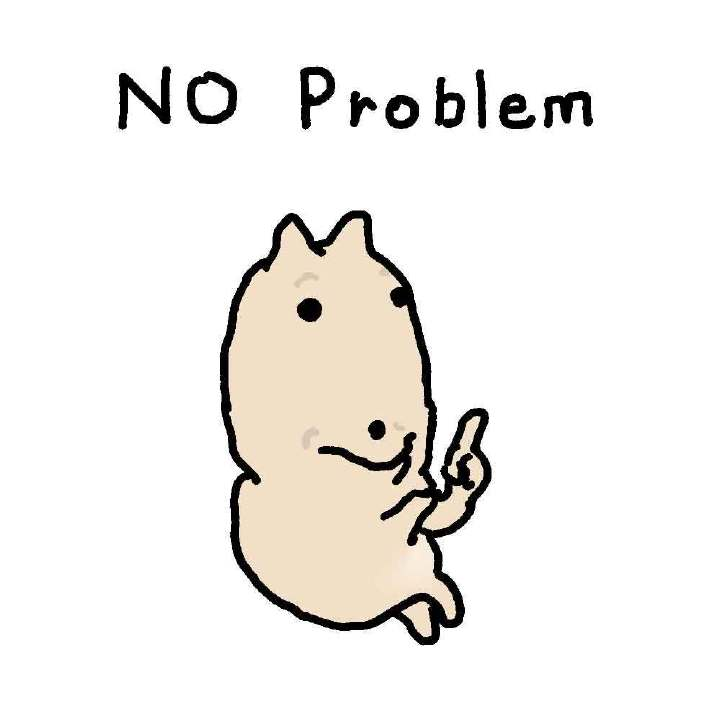

- **原文件名**：`161d2b1b28a64025463869627e34bed49efc9fbc7ad00e3beb6d04955cc2b9b7.0.JPG`
- **画面**：举手说“没问题”，有点自信又呆萌
- **适合语境**：答应小事、轻松表示可以、玩笑式打包票
- **把握程度**：较明确

### 02 · 兔兔挪动

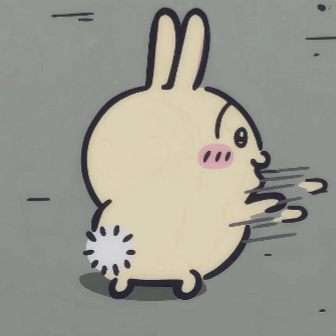

- **原文件名**：`1782180003059.gif`
- **画面**：兔子动作快速、像是在移动或逃走
- **适合语境**：溜走、赶路、躲开尴尬
- **把握程度**：初步理解

### 03 · 红衣猫点赞

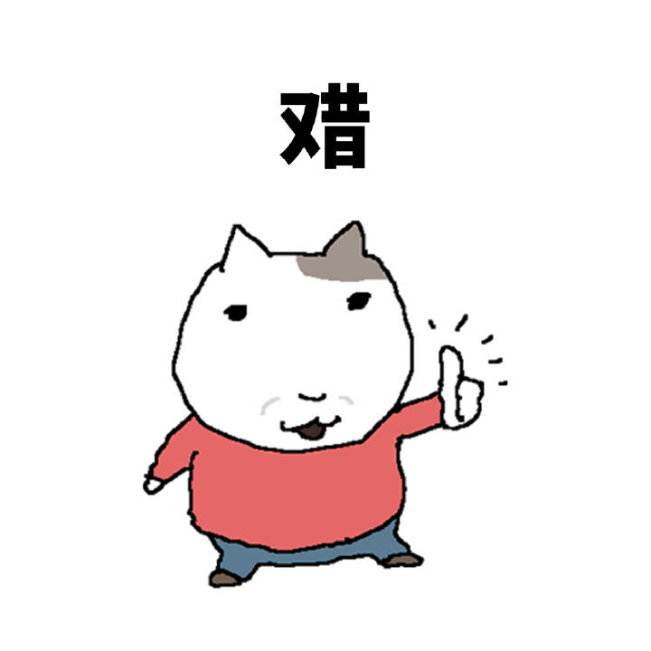

- **原文件名**：`36fef4faa8ff27cf217052b729a8e593ee4b4171105b2a9c02c083844367af05.0.JPG`
- **画面**：红衣猫竖大拇指，配字“赞”
- **适合语境**：认可、夸奖、敷衍式赞同
- **把握程度**：较明确

### 04 · 灰猫递钱

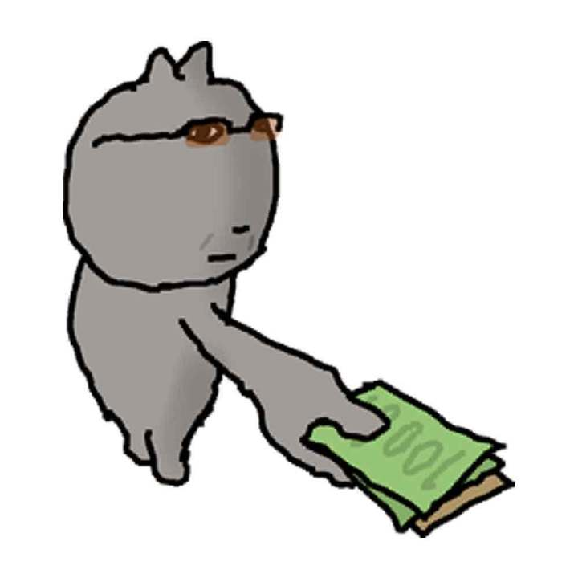

- **原文件名**：`6a517651473aa6825df7761f1ed36afa36e3dbd1cfbe2d6a9a6a9a92640c706d.0.JPG`
- **画面**：戴眼镜的灰猫伸手递出纸币
- **适合语境**：请客、给钱、买东西、调侃消费
- **把握程度**：较明确

### 05 · 红衣猫张牙舞爪

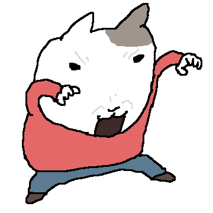

- **原文件名**：`893946dd50ea28837b0f3b368c987e170f2ae55a9781419eeec9d205c4888838.0.JPG`
- **画面**：张嘴、伸臂、叉腿，夸张做动作
- **适合语境**：兴奋、抓狂、放飞自我、搞怪
- **把握程度**：初步理解

### 06 · 兔兔吃瓜

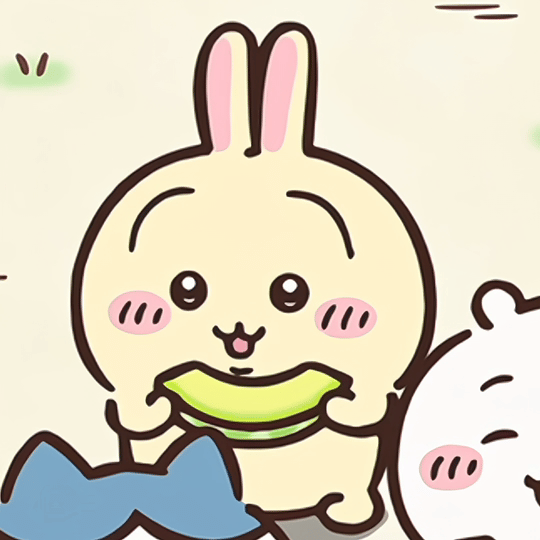

- **原文件名**：`IMG_1788016507357.gif`
- **画面**：兔兔双手抱着绿色瓜片吃
- **适合语境**：吃瓜、看热闹、吃得开心
- **把握程度**：较明确

### 07 · 兔兔侧脸吃瓜

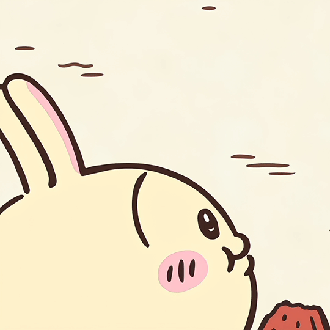

- **原文件名**：`IMG_1788016548494.gif`
- **画面**：兔兔侧脸吃红色瓜块
- **适合语境**：安静吃瓜、边吃边听八卦
- **把握程度**：初步理解

### 08 · 干嘛猫

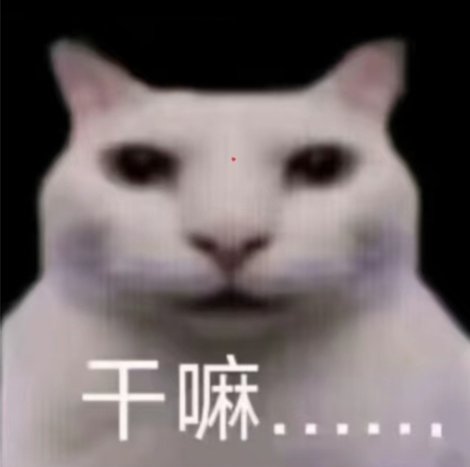

- **原文件名**：`IMG_20260623_111930.jpg`
- **画面**：白猫凝视镜头，配字“干嘛……”
- **适合语境**：突然被叫、疑惑、轻度无语
- **把握程度**：较明确

### 09 · 闪闪期待猫

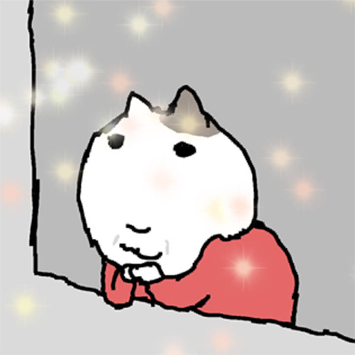

- **原文件名**：`c871ffb1da4c5593838fc4f1c1d6fb0dd5a90f7e0b8816c20a4975304850211e.0.JPG`
- **画面**：红衣猫托着脸，周围闪闪发亮
- **适合语境**：期待、开心、撒娇、被夸后美滋滋
- **把握程度**：初步理解

### 10 · 休 time 灰猫

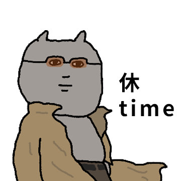

- **原文件名**：`d21ac1601a9dabece3814cc241a769ece584f489c89725c0a0d30f1b997149e0.0.JPG`
- **画面**：戴眼镜的灰猫，一脸正经，配字“休 time”
- **适合语境**：休息、下班、摆烂、结束工作
- **把握程度**：较明确

### 11 · 灰猫凝视

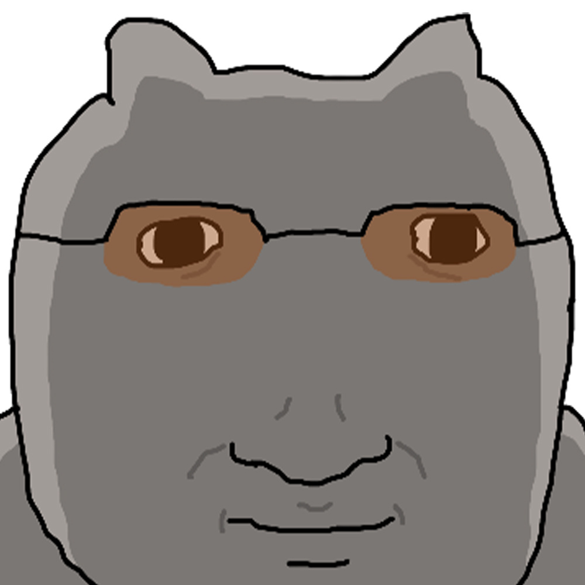

- **原文件名**：`dbd6f2a18e22ddd5a82c2d1490013ee63302e06cb943452211c7b797da7a4095.0.JPG`
- **画面**：戴眼镜的灰猫脸部特写，似笑非笑
- **适合语境**：意味深长地盯着、怀疑、沉默吐槽
- **把握程度**：初步理解

### 12 · 红衣猫看手机

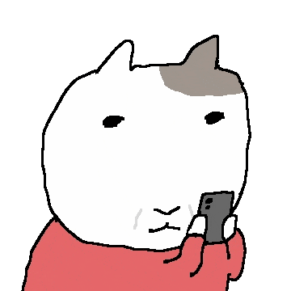

- **原文件名**：`mmexport0f68adafa53e90a44b695e553579681e_1782494760112.gif`
- **画面**：红衣猫看手机，反应不断变化
- **适合语境**：收到消息、看手机发懵、突然惊讶
- **把握程度**：初步理解

### 13 · 兔兔卖萌

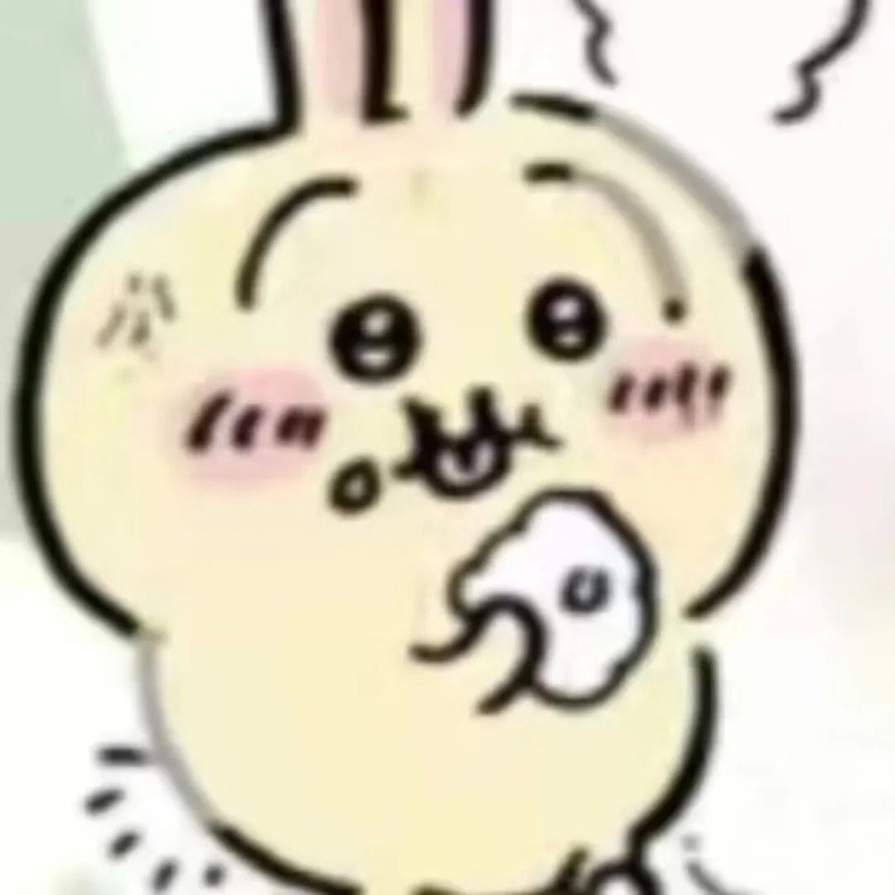

- **原文件名**：`mmexport1758188495154.jpg`
- **画面**：脸颊红红的大眼睛兔兔，举起爪子
- **适合语境**：卖萌、开心、撒娇、求关注
- **把握程度**：初步理解

### 14 · sorry sorry 帽子猫

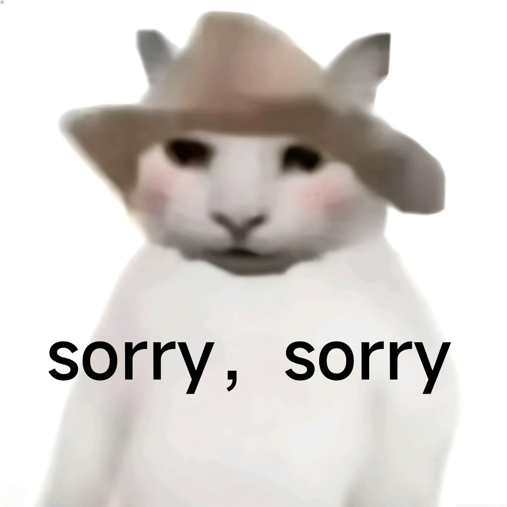

- **原文件名**：`mmexport1769406509817.jpg`
- **画面**：戴帽子的白猫，文字“sorry, sorry”
- **适合语境**：轻松道歉、犯了小错、可爱求和
- **把握程度**：较明确

### 15 · 红衣猫呆站

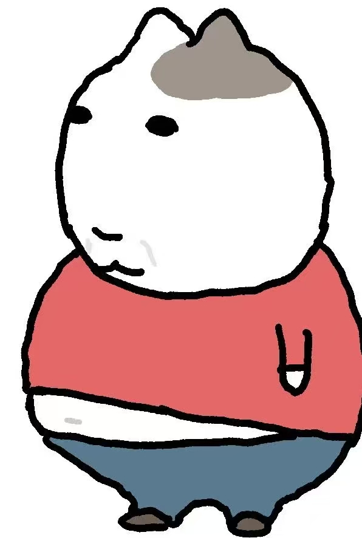

- **原文件名**：`mmexport1788527764626.jpg`
- **画面**：红衣猫站着，神情平静呆滞
- **适合语境**：呆住、发懵、不知如何接话
- **把握程度**：初步理解

### 16 · 红衣猫耸肩

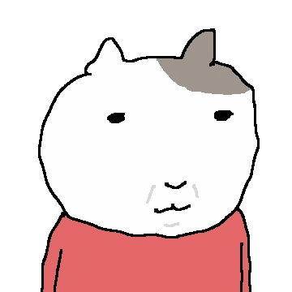

- **原文件名**：`mmexport92126502e65090eac684006968ed7de4_1782494764288.gif`
- **画面**：红衣猫耸肩、手臂摆动，有点理直气壮
- **适合语境**：无所谓、摊手、解释、调侃
- **把握程度**：初步理解

### 17 · 红衣猫嘘

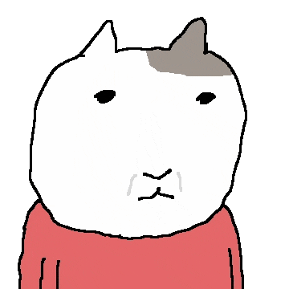

- **原文件名**：`mmexportcc958ff23f6d919d6f2d766a883399d8_1782494768033.gif`
- **画面**：红衣猫把手指举到嘴边，做嘘的动作
- **适合语境**：保密、别说、安静、神秘兮兮
- **把握程度**：较明确

### 18 · 红衣猫开心扭动

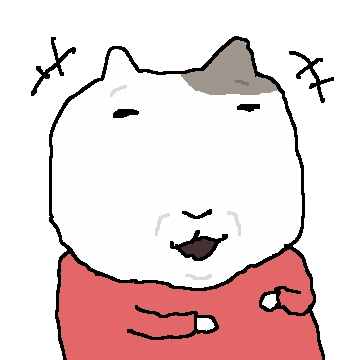

- **原文件名**：`mmexporte3b2f0c493e0e5f09abb5d77dc255a36_1782494773071.gif`
- **画面**：红衣猫笑眯眯左右扭动
- **适合语境**：高兴、得意、偷笑、小庆祝
- **把握程度**：较明确

## 后续维护

新增表情包时按同样格式补充，保持原文件名不变，以免旧直链失效。用户纠正含义后注明“用户已确认”。GIF 应根据整段动作理解，不只看第一帧。公开仓库里不要存私人信息。
